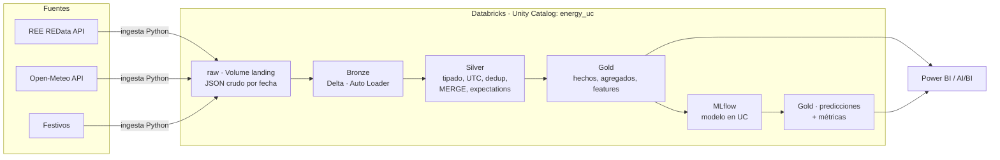

# Plataforma de datos del mercado eléctrico español (Databricks)

> En construcción. Fase actual: bronze y silver.

## 1. Problema y objetivo
¿Cómo evolucionan el precio y la demanda eléctrica en España? ¿Qué peso tienen las renovables y la meteorología? ¿Se puede prever la demanda del día siguiente?

Este proyecto tiene como objetivo construir una plataforma de datos en Databricks que responde a estas preguntas a partir de los datos públicos de Red Eléctrica (REE).

Para ello se realizan los siguientes puntos:
 - Ingesta desde la API de REE: por tramos, con reintentos y tolerante a fallos, guardando cada respuesta sin modificar (landing inmutable).
 - (En construcción) Arquitectura medallion (bronze ${\rightarrow}$ silver ${\rightarrow}$ gold)
 - (En construcción) Modelo de previsión de demanda con MLflow (tracking, registro e inferencia batch).
 - (En construcción) Gobierno con Unity Catalog: lineage, permisos y documentación de tablas.
 - Software estructurado: tests con pytest, pre-commit, entornos dev/prod e infraestructuras como código con Declarative Automation Bundle.
 - (En construcción) CI/CD

## 2. Arquitectura

## 3. Stack
Databricks (Free Edition, serverless) · Unity Catalog · Declarative Automation Bundles · Python (requests, tenacity) · pytest · ruff + pre-commit · GitHub

## 4. Cómo ejecutarlo

### Ingesta (REE → landing)
El job `ingesta_ree` descarga precios, demanda y generación de la API REData de REE y guarda cada respuesta, sin modificar, en el Volume `landing` (ver ADR 0002).

    # Despliegue
    databricks bundle deploy -t dev

    # Ejecución diaria (sin parámetros → los últimos 7 días, para recoger revisiones de REE)
    databricks bundle run ingesta_ree -t dev

    # Backfill de un rango concreto
    databricks bundle run ingesta_ree -t dev --params inicio=2024-01-01,fin=2024-12-31

    # Tests
    uv run pytest tests/unit/ -v --noconftest

## 5. Decisiones técnicas
- [ADR 0001 – Arquitectura medallion](docs/adr/0001-arquitectura-medallion.md)
- [ADR 0002 – Landing inmutable con idempotencia en silver](docs/adr/0002-landing-inmutable.md)
- [Exploración de la API de REE](docs/exploracion_ree.md)

## 6. Resultados
_Pendiente._

## 7. Limitaciones y próximos pasos
_Pendiente._